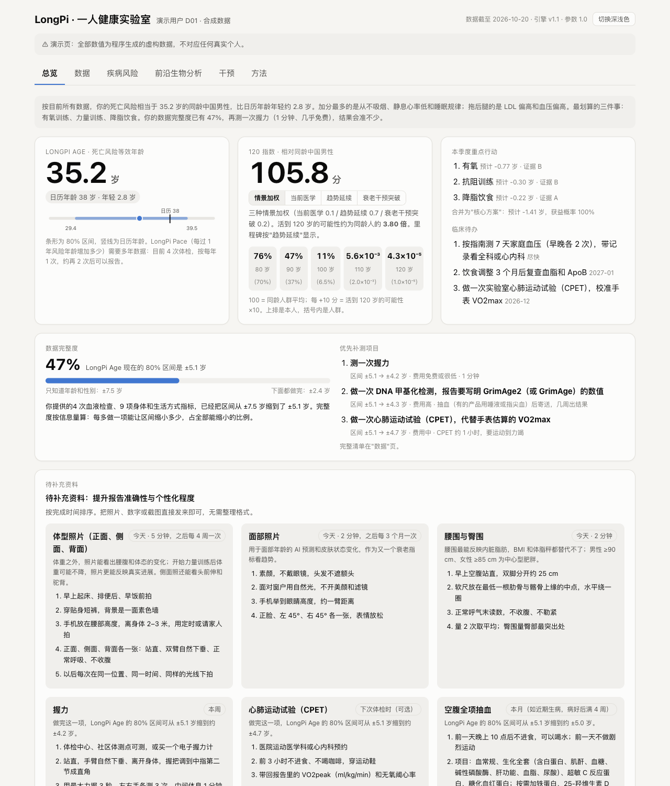
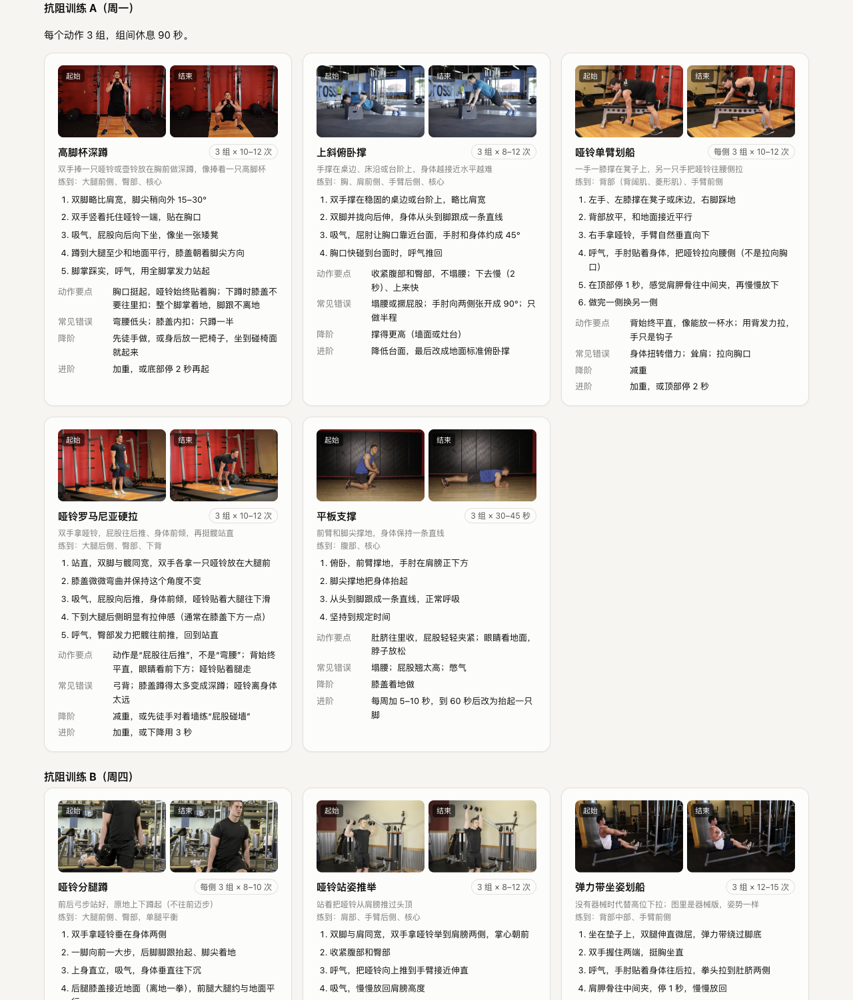

# LongPi Report

**基于个人健康数据的长寿报告生成工具（Claude Code Skill）**

LongPi Report 将个人的体检化验、可穿戴设备、连续血糖、家庭血压、基因与 DNA 甲基化数据整理为一份单文件网页报告。报告内容包括：

- LongPi Age（死亡风险等效年龄）
- 120 指数与个人生存曲线
- 疾病风险卡与药物基因组提示
- 干预效果预测、运动方案与补充剂建议
- 补测清单与数据完整度

报告中的全部数值由同一个经公共数据校准并做过外部验证的死亡风险模型计算。Claude 负责阅读资料、整理输入、撰写叙述和解释，不自行估算任何数值。

> *English summary.* A Claude Code skill that turns a person's checkups, wearables, CGM, home blood pressure, genetic and methylation reports into a single-file longevity report: LongPi Age (risk-equivalent age), a 120 Index, survival curves, risk cards, intervention forecasts, an exercise programme with illustrated movements, and a data-completeness score showing which further test would sharpen the result most. Every number comes from one mortality model calibrated and temporally validated on public data (UN WPP 2024, NHANES 1999–2018 with mortality follow-up, NHANES 1999–2002 DNA methylation). Report text is in Chinese.



## 主要特点

| 特点 | 说明 |
|---|---|
| 数值可溯源 | 剂量反应参数逐条核对原文（`evidence/literature/`）；合并方式在 NHANES 中校准；参考死亡率取自联合国 WPP 2024 中国生命表 |
| 外部验证 | NHANES 1999–2018（50,819 人，8,279 例死亡）时间外推验证：按美国人群吸烟危害计算时，LongPi 1 岁对应的风险与日历年龄 1 岁一致（斜率比 1.03，95% CI 0.94–1.12）；C 指数由 0.835 提高至 0.863 |
| 缺失数据如实处理 | 未测项目按同龄人群分布或 NHANES 残差分布计入，点估计保持中性，仅加宽区间 |
| 补测清单 | 逐项计算补做某项检测后区间可缩小多少，并给出按信息量加权的数据完整度 |
| 甲基化 | 仅计入 GrimAge2 / GrimAge 在已有信息之外的增量（NHANES 1999–2002 甲基化数据，2,307 人，随访中位 17 年），并按实验室间差异收缩 |
| 异常期血检 | 自动识别急性炎症期和红细胞指标异常的化验，给出排除后的对照结果 |
| 运动方案 | 内置 24 个动作的图文库（起止姿势照片、步骤、要点、常见错误、降阶与进阶） |
| 离线单文件 | 报告为单个 HTML，不加载任何外部资源，支持深浅色与手机浏览 |



## 安装

需要 [Claude Code](https://claude.com/claude-code)，运行时仅依赖 Python 3.9+ 标准库，无需联网。

以插件方式安装（推荐）：

```bash
claude plugin marketplace add Longevity-Pioneer/longpi-report
claude plugin install longpi-report@longpi-report
```

或作为个人 Skill 安装：

```bash
git clone https://github.com/Longevity-Pioneer/longpi-report.git
cp -R longpi-report/skills/longpi-report ~/.claude/skills/
```

两种方式只需选择其一，同时安装会出现两个同名 Skill。

## 使用

在 Claude Code 中输入 `/longpi-report`，或直接说明"根据我的数据生成 LongPi 报告"，并提供资料所在的文件夹。可提供的资料包括：

- 体检报告（PDF 或照片）
- Apple 健康导出的 zip；其他品牌手表的导出文件
- 连续血糖、家庭血压记录
- 基因检测与甲基化报告

Claude 将按 `skills/longpi-report/SKILL.md` 的流程依次完成：整理 `person.json`、检查输入、计算、撰写叙述，最后生成 `report.html`。个人资料与产出均保存在单独的工作文件夹中，不写入 Skill 目录。

也可直接运行命令行：

```bash
cd skills/longpi-report
python3 scripts/longpi_report.py demo    -o /tmp/longpi_demo          # 合成示例，端到端
python3 scripts/longpi_report.py check   person.json                  # 检查输入
python3 scripts/longpi_report.py compute person.json -o results.json  # 计算
python3 scripts/longpi_report.py facts   results.json                 # 撰写叙述用的事实表
python3 scripts/longpi_report.py render  results.json narrative.json -o report.html
python3 -m unittest discover -s tests                                 # 25 项测试
```

合成演示报告见 `skills/longpi-report/examples/output/report.html`。

## 模型概要

- **LongPi Age** = 年龄 + ln E[R] / b
  - b 为 WPP 2024 中国生命表 35–90 岁的 Gompertz 斜率（男性约 0.0985/年）。
  - R 为相对同龄、同性别中国人的死亡风险倍数，由三部分合成：
    - 血液时钟层：PhenoAge 差值，在 NHANES 中分段校准；
    - 甲基化增量：GrimAge2 / GrimAge；
    - 十个功能领域：心肺适能、握力、静息心率、睡眠、血压、LDL、血糖、BMI、吸烟、饮酒。剂量反应来自荟萃分析或随机对照试验，并按中国人群分布归一化。
- **120 指数** = 100 + 10 × log10（本人活到 120 岁的概率 ÷ 同龄人群的概率）
  - 96 岁以上接入超百岁老人的死亡率平台，个人生存曲线采用 Gamma 脆弱性模型。
  - 设三种情景：死亡率维持当前水平、WPP 中位预测、延缓衰老。
- **干预预测**：随机对照试验中的指标变化乘以现实依从性，代入同一模型计算；无可靠人体结局证据的项目不给数值。

完整论证见[方法学白皮书](docs/方法学白皮书.md)，代码层面的计算规则、参数总表与核对清单见[技术文档](docs/技术文档.md)。技术文档中的表格由 `docs/tools/gen_tech_tables.py` 从代码和数据直接生成，可用 `--check` 校验一致性。

## 目录结构

```
skills/longpi-report/        Skill 本体（运行时）
  SKILL.md                   工作流程与规则
  scripts/longpi_report.py   命令行入口
  scripts/lp/                引擎：参考死亡率、时钟层、功能领域、合成、临床计算器、可穿戴、渲染、检查
  data/                      生命表、参数（含出处）、中国人群分布、PhenoAge 参考、生物学变异、动作库
  assets/                    报告模板与动作图片
  references/                输入格式、叙述规范、风险卡规则、药物基因组、解释口径、方法摘要
  examples/                  合成演示用户 D01（输入、叙述、输出）
  tests/                     单元与端到端测试
evidence/                    证据流水线，可由公共数据完整复现
  scripts/                   数据下载、生命表、NHANES 校准与验证、甲基化分析、情景历史、敏感性分析、动作库构建
  literature/                文献参数核实记录（原句、DOI、PMID）
  results/                   校准、验证与敏感性分析结果
docs/                        方法学白皮书、技术文档、图表
```

## 复现证据流水线

原始数据约 1 GB，不包含在仓库中，可用脚本下载后复现全部校准与验证结果，步骤见白皮书第 9 节：

```bash
cd evidence
bash scripts/fetch_public_data.sh raw
python3 -m venv .venv && .venv/bin/pip install pandas numpy scipy lifelines matplotlib pyarrow
```

## 数据与素材许可

| 来源 | 许可 |
|---|---|
| 联合国《世界人口展望 2024》 | CC BY 3.0 IGO |
| NHANES、NHANES 死亡随访与甲基化生物标志物（美国 CDC/NCHS） | 公共领域 |
| 动作图片：Free Exercise DB（github.com/yuhonas/free-exercise-db） | The Unlicense（公共领域） |
| China-PAR 计算实现：longevity-skills | MIT |

本项目代码以 MIT 许可发布，见 [LICENSE](LICENSE)。

## 声明

本工具用于健康管理与科研，报告中的模型估计均为 AI 预测，不构成医学诊断或治疗建议。处方药相关内容仅说明证据，用药须由医生决定。急症请立即就医。
