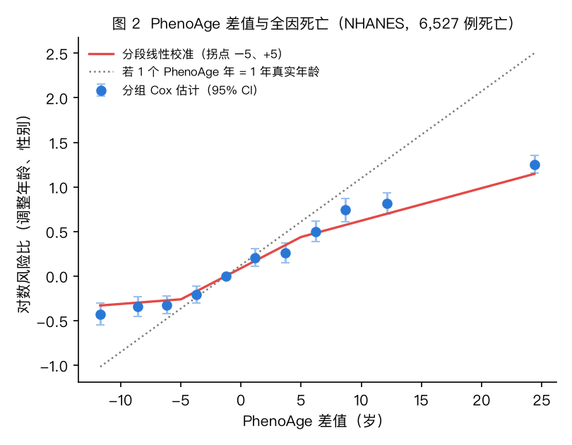
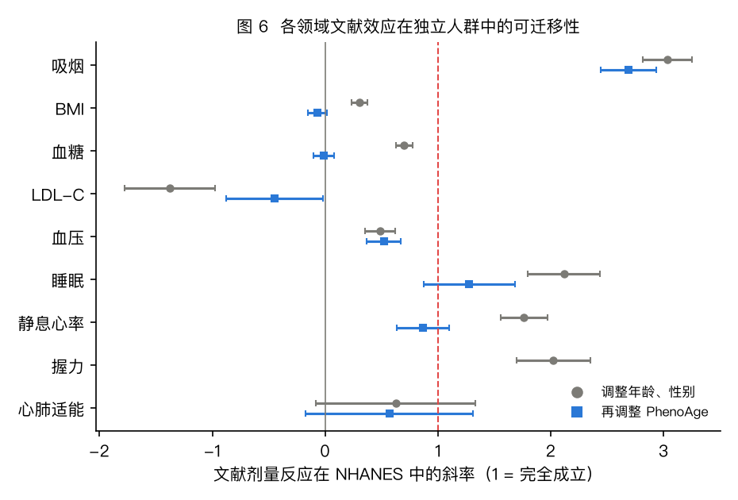
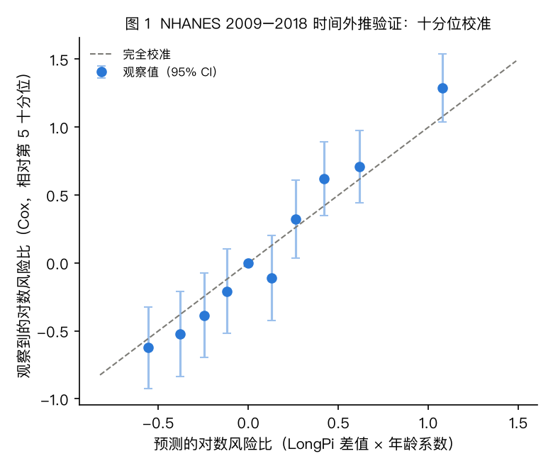
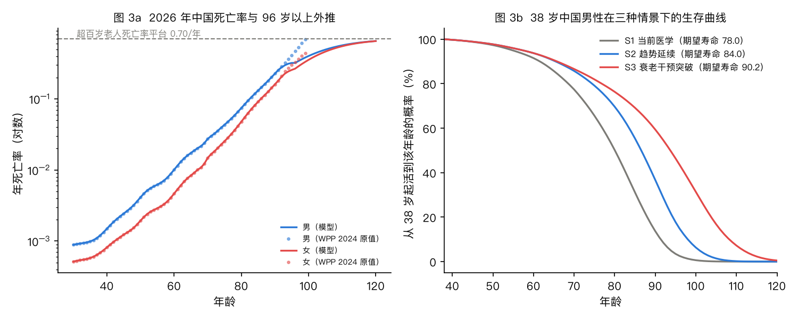
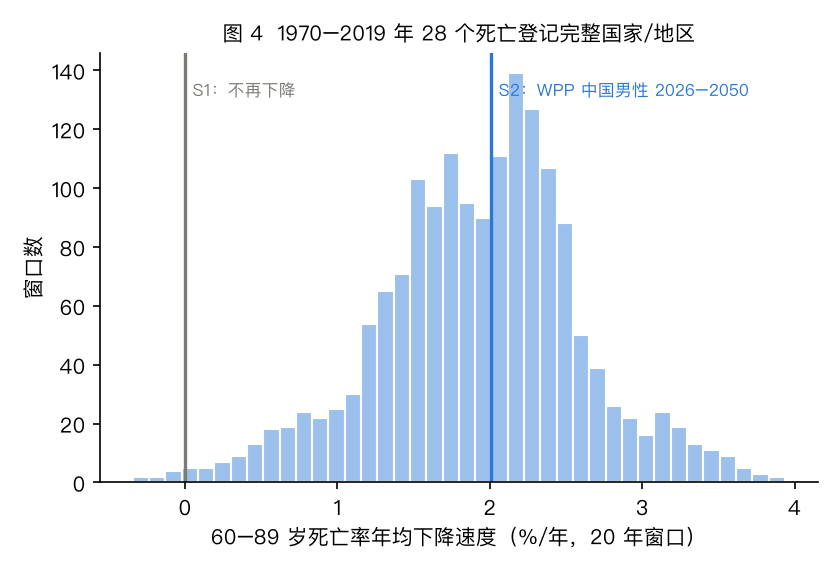
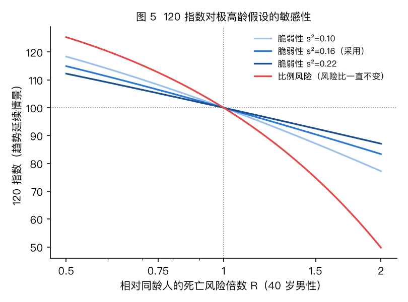

# LongPi 报告的算法与科学依据

**方法学白皮书 v1.1 · 2026-10-24**（v1.1 增加：没有血液检测时的不确定性、甲基化时钟、补测清单与数据完整度）

适用范围：LongPi Age（死亡风险等效年龄）、120 指数、个人生存曲线、LongPi Pace、干预效果预测。
代码：`skills/longpi-report/`（运行时，仅用 Python 标准库）；证据与验证：`evidence/`（可从公共数据完整复现）。

---

## 摘要

LongPi 报告的每一个数字都由同一个模型计算。模型的结构、参数和验证全部基于公共数据，没有任何一个数字靠人为设定。

1. **LongPi Age** 是"风险提前期"（rate advancement period）意义下的等效年龄：先把一个人的全因死亡风险，表示成相对同龄同性别中国人的倍数 R，再按中国生命表的 Gompertz 斜率 b（男 0.0985/年）换算成年数，即 `年龄 + ln R / b`。
2. R 由三部分合成：
   - **血液时钟层**：Levine PhenoAge 相对同龄人的差值，在 NHANES 里做分段校准。
   - **甲基化时钟**：只计入 GrimAge2 / GrimAge。在 NHANES 1999–2002 甲基化数据（2,307 人，随访中位 17.2 年）里，它们在 LongPi 已有信息之外每 1 个标准差 HR 1.27；其他时钟增量很小，不计入。
   - **10 个功能领域**：心肺适能、握力、静息心率、睡眠、血压、LDL、血糖、BMI、吸烟、饮酒。每个领域用荟萃分析或随机对照试验的剂量反应关系，再按中国人群分布归一化。
3. **外部验证**：用美国 NHANES 1999–2018（50,819 人，8,279 例死亡）的前十年数据定系数，在后十年 15,389 人中检验：
   - LongPi Age 的 1 岁对应死亡风险比 1.114，真实年龄 1 岁对应 1.101。
   - 改用美国人群的吸烟危害后，斜率比为 **1.03（95% CI 0.94–1.12）**，即 LongPi 的 1 岁就是 1 岁的风险。
   - 区分能力 C 指数从 0.835 提高到 0.863。
   - 作为对照，原 Demo 的拼法斜率比只有 0.47：它的 1 岁只值半岁。
4. **120 指数**用联合国 WPP 2024 中国生命表做参考：96 岁以上接上超百岁老人的死亡率平台（0.70/年），个人生存曲线用 Gamma 脆弱性模型。因此指数主要反映"你相对同龄人的位置"，对超高龄数据的不确定性不敏感：风险高 25% 的人，在所有假设下都落在 91.9–96.9 分；若假设风险比一生不变，会在 81.6–94.3 之间大幅摆动。
5. **干预预测**取随机对照试验中的指标变化量，乘以现实依从性，放进同一个模型计算。所以"做完再测"时，LongPi Age 的变化和预测是一致的。没有可靠人体结局证据的干预（D 级）不给数值。
6. **区间与数据完整度**：区间表示"把能测的都测了以后，LongPi Age 有八成把握落在哪里"。没测的部分（功能领域、血液检测、GrimAge2）都按公共数据中的分布计入：点估计不变，区间变宽。
   - 报告逐项算出"补哪一项、区间缩多少"。
   - 数据完整度按信息量加权，鼓励用户补测真正有用的数据。

---

## 1. 设计原则

- **一个模型，处处一致**：总览、瀑布图、生存曲线、120 指数和干预预测都来自同一个风险倍数 R。
- **参数来自公开证据，权重来自公共数据校准**：剂量反应取自荟萃分析和随机对照试验；各部分如何合并（重叠折扣、PhenoAge 换算系数）在独立的公共队列 NHANES 中估计和检验。
- **缺失数据不假装**：没测的领域从同龄同性别中国人分布中抽样；没有血液检测、没有 GrimAge2 时，从 NHANES 估计的残差分布中抽样。点估计严格中性（用期望风险 E[R]），只让区间变宽。报告逐项量化"补测哪一项，区间能窄多少"，并给出按信息量计的数据完整度（§3.9）。
- **保守优先**：美国数据显示某项关联比文献更强时，不用它放大效应，只在显示更弱或与其他指标重叠时打折扣。
- **可复现**：`evidence/scripts/` 从下载原始公共数据开始，到生成本文所有数字和图为止，全流程脚本化。

## 2. 公共数据

| 数据 | 用途 | 来源 |
|---|---|---|
| 联合国《世界人口展望 2024》单岁生命表（中国，1950–2100，中位预测） | 参考死亡率、Gompertz 斜率、趋势延续情景 | population.un.org/wpp，CC BY 3.0 IGO |
| 同上，28 个死亡登记完整的国家/地区 1950–2023 | 死亡率改善速度的历史分布（情景权重） | 同上 |
| 美国国家健康与营养调查 NHANES 1999–2018，及其 2019 年公共死亡随访 | PhenoAge 参考曲线、全部校准与外部验证 | CDC/NCHS |
| 中国慢性病及危险因素监测 2018（CCDRFS）、中国居民营养与健康状况监测（CNHS）、第六次全国国民体质监测公报（2025）、中国跑步机心肺运动试验参考值（Huang 2024）等 | 同龄同性别中国人的分布（归一化） | 见 `evidence/literature/D_china_population_norms.md` |
| 欧洲检验医学联合会生物学变异数据库（EFLM） | PhenoAge 单次测量噪声 | biologicalvariation.eu（2026-10-24 访问） |
| NHANES 1999–2002 DNA 甲基化表观遗传生物标志物（dnmepi，2024-07-31 发布；50 岁以上，EPIC 芯片） | 各甲基化时钟在 LongPi 之外的增量、参考曲线 | wwwn.cdc.gov/nchs/nhanes/dnam |
| 超百岁老人数据（Barbi 2018；IDL：Gampe 2021；Pearce & Raftery 2021） | 极高龄死亡率平台 | 文献 |

文献参数均由检索代理逐条打开原文核对，记录了原句、DOI 和 PMID，见 `evidence/literature/A–F_*.md`。

## 3. LongPi Age

### 3.1 定义

成年人死亡率随年龄近似指数上升（Gompertz 规律）：μ(x) ≈ a·e^{bx}。风险高 R 倍，等价于年龄提前 ln R / b 年。这就是流行病学中的"风险提前期"（Brenner 等 1993；公式 ln HR_暴露 / ln HR_年龄，见 Ordóñez-Mena 等 2016）。PhenoAge 本身也是用这种方式把死亡风险换算成年龄的（Liu 等 2018）。

b 取 2026 年 WPP 中国生命表 35–90 岁对数死亡率的斜率：**男 0.0985/年，女 0.104/年**，即每长 1 岁风险上升约 10%（原 Demo 用的是 0.09）。

- 换算核对：40–80 岁之间，`年龄 + ln R / b` 与按生命表精确反解"哪个年龄的死亡率等于 R 倍"相差不超过 1 岁（多数在 0.6 岁以内）。35 岁以下死亡率曲线被意外伤害拉平，精确反解会失真，所以采用斜率换算（`evidence/results/sensitivity.json`）。
- 解读边界：风险提前期不等于预期寿命之差，也不是生存曲线的平移（Discacciati 等 2016）。报告一律说"风险相当于几岁"。

`LongPi Age = 年龄 + ln E[R] / b`，其中 ln R = g(G) + Σ_d c_d · l_d(x_d)。

### 3.2 血液时钟层

**PhenoAge**：完全采用 Levine 等（2018）Supplement 1 的系数和常数（141.50225、0.090165、γ = 0.0076927）。实现与 BioAge 的 `phenoage_calc(orig = TRUE)` 逐位一致（单元测试）。注意 Liu 2018 的勘误版用的是 0.09165，两者相差约 1.5 岁。

**参考曲线**：PhenoAge 差值 G = PhenoAge − 同龄同性别参考值。参考值来自 NHANES 1999–2010 和 2015–2018（含 CRP 的周期），共 37,192 人，用体检权重做二次回归拟合。NHANES 2015–2018 中亚裔美国人的平均差值为 +0.26 岁（1,250 人），说明这条参考曲线大体也适用于东亚人群。

**单次噪声**：PhenoAge 对它的线性预测值严格线性，PhenoAge = 141.50225 + (0.08679 + xb)/0.090165，所以可以把 EFLM 的个体内生物学变异（CVI）和检测不精密度解析地传播进去。典型值下，单次测量的标准差为 **1.8 岁**，其中 58% 来自 RDW，12% 来自血糖。两次测量相差超过 **5.0 岁**（95% 参考变化值）才算确定的变化；报告据此决定能不能明确说"年轻了"。

**多次测量的合并**：用局部水平卡尔曼滤波。
- 先验：同龄人差值分布扣除测量噪声。
- 过程噪声：每年 0.8 年²，取自 NHANES 中差值方差随年龄增长的速度。
- 没有 hs-CRP 时按 1.0 mg/L 补入，并加上 ln CRP 在人群中的方差。

**校准：不是 1:1**。在 NHANES（6,527 例死亡）中，同时调整年龄和性别后：
- PhenoAge 差值每 1 岁对应 HR 1.049，真实年龄每 1 岁对应 1.102。
- 关系是非线性的（图 2）：差值 ±5 岁以内每 1 岁 ≈ 0.071 个对数风险单位，约合 **0.71 个风险年**；比同龄人年轻 5 岁以上后几乎不再加分（斜率 0.010）；老 5 岁以上每岁 0.037。
- 采用与功能领域一起拟合的分段线性函数 g（拐点 −5、+5）。

已发表文献报告的 HR 为每岁 1.09（Levine 2018；Liu 2018），我们按其样本设定（1999–2010 年，随访至 2011 年）复现得到 1.054，差异的原因无法从公开材料确定。差异不影响本模型：我们用的是自己在公共数据上可复现的估计。



### 3.3 功能领域

每个领域 d 有一条剂量反应曲线 f_d（全因死亡的对数风险比），并按同龄同性别中国人分布归一化：
`l_d(x) = f_d(x) − ln E_pop[exp f_d(X)]`，使人群平均风险等于生命表风险。

| 领域 | 剂量反应（全因死亡） | 出处 | 中国人群分布 |
|---|---|---|---|
| 心肺适能 | 每 +1 MET（3.5 ml/kg/min）RR 0.89（0.86–0.92） | Laukkanen 2022 Mayo Clin Proc | 中国跑步机 CPET（Huang 2024），60 岁以上按 FRIEND 递减 |
| 握力 | 每 −5 kg HR 1.16（1.13–1.20） | Leong 2015 Lancet（PURE，含中国） | 第六次国民体质监测（2025） |
| 静息心率 | 每 +10 bpm RR 1.09（1.07–1.12） | Zhang 2016 CMAJ | 2014 国民体质监测；CHARLS |
| 睡眠（问卷口径） | 7 h 以下每少 1 h RR 1.06（1.04–1.07）；8 h 以上每多 1 h RR 1.13（1.11–1.15） | Yin 2017 JAHA；7–8 h 参照区间见 Cappuccio 2010 | CCDRFS 2018 |
| 收缩压（诊室口径） | 每低 10 mmHg：Ettehad 2016（RR 0.87，0.84–0.91）与 BPLTTC 2021（每 5 mmHg HR 0.98，0.96–1.01）各占一半，即 0.915（0.84–1.00）；115 mmHg 以下不再获益 | 随机对照试验荟萃 | CCDRFS 2018；70 岁以上用 CHARLS 增量 |
| LDL-C | 每低 1 mmol/L RR 0.91（0.85–0.97） | CTT 2012（无血管病人群） | CANCDS 2015 |
| 血糖（ADA 分级） | 糖尿病前期 RR 1.07（1.03–1.12）；糖尿病 RR 2.00（1.93–2.08） | Cai 2020 BMJ；Bragg 2017 JAMA（CKB） | CCDRFS 2018 |
| BMI | 22.5–25 最低；25 以上每 +5 HR 1.39（1.34–1.44）；22.5 以下每 −2.5 约 1.10 | GBMC 2016 Lancet（东亚） | CNHS 2015–17 |
| 吸烟 | 现吸 HR 1.33（全国男性；城市 1.65、农村 1.22）；戒烟不满 5 年 1.21；满 5 年 1.00 | Chan 2022；Chen 2015（CKB） | CCDRFS 2018 |
| 饮酒 | 每 +100 g/周 HR 1.07（1.05–1.10），遗传分析，无保护效应 | Millwood 2023 Lancet Public Health（CKB） | CCDRFS 2018（WHO 克数分档） |

**设备与口径换算**（均在蒙特卡洛中带不确定性）：
- 手表 VO2max 按品牌校正：Apple +4 ± 3（研究中读数偏低约 6，受试者偏健康）；佳明、Firstbeat、华为（Firstbeat 授权算法）0 ± 1.5。华为研究相对功率车测得 +1.11，而功率车本身比跑步机低，换到跑步机口径后接近 0。
- 手表静息心率加 5 ± 3 bpm，折算为诊室坐位口径。这一项没有直接研究，按白天与夜间、坐位与卧位的差值间接推断。
- 手表睡眠按 Lauderdale 2008 的多报关系换算为问卷口径（5 小时时多报 1.2 小时，7 小时时 0.4 小时）。
- 家庭血压按《中国高血压防治指南（2024）》的对应关系换算为诊室口径：130/80 两者相同；家庭 135/85 对应诊室 140/90。

### 3.4 合并系数：用公共数据决定"打几折"

把各领域的对数风险比简单相加，会重复计算相互重叠的部分。原 Demo 统一乘 λ = 0.5。我们改在 NHANES 中逐项检验，再按三条规则确定系数 c_d：

1. **因果领域**（血压、LDL、吸烟、饮酒）：c = 1。效应量来自随机对照试验或遗传分析，干预后的变化可以直接按它计算。
2. **重叠领域**（血糖、BMI、静息心率）：c 取 NHANES 联合 Cox 模型的估计。有 PhenoAge 时，血糖和 BMI 的系数仅 0.03：PhenoAge 本身包含血糖和炎症，它们的预测信息几乎都已计入。没有 PhenoAge 时，两者分别为 0.59 和 0.22。
3. **其余领域**（睡眠、心肺、握力）：把 NHANES 估计和文献先验（1，SD 0.3）合并，**只打折，不放大**。

可迁移性检验（图 6）：
- 调整 PhenoAge 后，静息心率（0.87）和睡眠（1.28）的文献效应在美国人群中基本成立。
- 握力（2.02）和吸烟（3.03）的关联比文献更强。美国吸烟者的相对风险约 2.4，高于中国 CKB 的 1.33。
- 血压（0.49）偏弱，原因是单次测量的回归稀释和降压治疗的混杂。
- 观察性 LDL 斜率为负（−1.38）。这是经典的反向因果和混杂，所以 LDL 只采用 CTT 的因果效应。



### 3.5 外部验证

做法：用 NHANES 1999–2008 周期估计全部校准量，再在从未参与估计的 2009–2018 周期中检验。

| 指标 | 有血液时钟 | 无血液时钟 |
|---|---|---|
| 检验人数 / 死亡 | 15,389 / 1,051 | 27,306 / 2,211 |
| LongPi 1 岁对应的 HR | 1.114 | 1.119 |
| 真实年龄 1 岁对应的 HR | 1.101 | 1.095 |
| 斜率比（理想值 1） | 1.12（1.02–1.22） | 1.24（1.11–1.36） |
| 斜率比（改用美国吸烟危害） | **1.03（0.94–1.12）** | **1.03（0.93–1.12）** |
| C 指数：年龄 + 性别 → 加入 LongPi | 0.835 → 0.863 | 0.829 → 0.843 |
| 对照：PhenoAge 1:1 / 原 Demo 拼法的斜率比 | 0.54 / 0.47 | — |

斜率比大于 1 表示模型对风险差异的估计偏保守。改用美国吸烟强度后斜率比回到 1.03，说明这点保守完全来自中美吸烟危害的差异；对中国用户而言，用 CKB 的相对风险才是正确的。十分位校准见图 1。



### 3.6 不确定性

每次计算做 2,000 次蒙特卡洛抽样，同时传播以下来源：
- 剂量反应参数的置信区间；
- 校准系数的标准误；
- PhenoAge 差值的后验分布；
- 测量误差和设备偏差；
- 人群均值本身的不确定性（中国 VO2max 常模取 ±2.5）；
- 未测领域的人群分布；
- 脆弱性方差。

- 没有血液检测时，血液时钟那一块的残差（§3.7）；
- 没有 GrimAge2 时，甲基化那一块的残差（§3.8）。

点估计用期望风险 E[R]，区间取第 10 和第 90 百分位（80% 区间）。

### 3.7 没有血液检测时

没有血液检测时，模型改用"无时钟"系数组，但风险里血液时钟能看到的那一块并没有消失，只是看不到。

**估计方法**：在 NHANES 1999–2018 有 PhenoAge、核心领域齐全的 35,086 人（5,891 例死亡）中，以无时钟的 LongPi 对数风险、年龄、性别为自变量，回归有时钟的 LongPi 对数风险，取残差的加权标准差。

| 年龄 | 20–39 | 40–59 | 60–74 | 75–85 |
|---|---|---|---|---|
| 残差 SD（对数风险） | 0.28 | 0.31 | 0.34 | 0.37 |
| 约合 LongPi 年数（1 SD） | 2.9 | 3.1 | 3.4 | 3.8 |

这一块是真实的死亡风险信息：把残差加入无时钟模型后，C 指数从 0.852 升到 0.865。

**在引擎中的处理**：
- 没有血液检测时，按 N(−σ²/2, σ²) 抽样，所以人群平均风险仍为 1，点估计不变，只加宽区间。
- 一次抽血就能把它换成单次测量噪声（约 ±1.8 年 PhenoAge，换算后约 ±1.2 年）。

### 3.8 甲基化时钟

**数据**：NHANES 1999–2002 的甲基化公开数据，2024-07-31 由 NCHS 发布。
- 对象：50 岁以上成人，全血 EPIC 芯片，杜克大学检测。
- 内容：Horvath、Hannum、DNAm PhenoAge、GrimAge、GrimAge2、DunedinPoAm 等时钟，以及专用权重 WTDN4YR。
- 与死亡随访相连后：2,307 人（50–85 岁）有甲基化、血液 PhenoAge 和核心领域数据，随访中位 17.2 年，1,202 例死亡。

**做法**（`evidence/scripts/nhanes_methylation.py`）：
1. 用引擎的系数和 NHANES 自身的同龄人分布，算出每人的 LongPi 对数风险 LP。在这个子样本里，LP 的 Cox 系数为 0.99，即 LongPi 本身是准的。
2. 对每个时钟算加速 A：时钟值减去按性别、年龄的加权线性参考值。
3. 再算残差 M：A 减去以 LP、年龄、性别回归得到的预期值，M 与 LP 不相关。
4. Cox 模型：年龄 + 性别 + LP + M。M 的系数就是这个时钟在 LongPi 之外的增量。另做 WTDN4YR 加权的稳健标准误敏感性分析。

| 时钟 | 单独：HR/SD | 被 LongPi 解释的方差 | LongPi 之外：HR/SD 残差 | p | C 指数增加 | 加权 HR |
|---|---|---|---|---|---|---|
| GrimAge2 | 1.55 | 26% | **1.27** | 1×10⁻¹⁵ | +0.0067 | 1.34 |
| GrimAge | 1.51 | 22% | **1.27** | 2×10⁻¹⁶ | +0.0068 | 1.33 |
| DunedinPoAm | 1.35 | 17% | 1.15 | 1×10⁻⁶ | +0.0025 | 1.19 |
| DNAm PhenoAge | 1.22 | 6% | 1.11 | 3×10⁻⁴ | +0.0016 | 1.14 |
| Horvath | 1.12 | 0.5% | 1.09 | 0.003 | +0.0011 | 1.09 |
| Hannum | 1.13 | 2% | 1.08 | 0.003 | +0.0009 | 1.12 |
| DNAm 端粒长度 | 0.83 | 2% | 0.84 | 2×10⁻⁹ | +0.0042 | 0.82 |

**结论**：GrimAge2 和 GrimAge 在 LongPi 之外还带着明显的死亡风险信息。第一代时钟（Horvath、Hannum）几乎没有。所以只计入 GrimAge2 / GrimAge：
- DunedinPACE 不在公开的死亡随访数据里，DunedinPoAm 是它的旧版。
- DNAm 端粒长度很少有商业报告给出。

**在引擎中的处理**：
- 计入项为 β·M − β²σ_M²/2。GrimAge2 的 β 为 0.053/年（SE 0.0066），σ_M 为 4.51 年。
- 用户的测量值来自另一家实验室和另一个人群，会有系统差异，所以 M 按正态—正态收缩：
  - 实验室差异 s_lab = 2.4 年：McEwen 2018 用同一批样本比较 450K 与 EPIC 芯片在不同预处理下的甲基化年龄，中位绝对差 1.44–3.10 年，折合每条流程的 SD 约 1.5–3.3 年，取中点。
  - 人群差异 s_pop = 0.71 年：NHANES 里含亚裔的"其他人种"组的平均残差。
  - 收缩系数 k = σ_M² / (σ_M² + s_lab² + s_pop²) = 0.77。
- 没测时，M 从 N(0, σ_M²) 抽样，只加宽区间。约合 LongPi 年数 ±2.4 年（1 SD）。
- M 相对的是 LongPi 的点估计，而不是每次抽样的值。这是保守的做法：不假设甲基化还能替代其他指标。在 NHANES 里，GrimAge2 对"缺失的血液时钟"只能替代 7%（残差 SD 0.312 → 0.289）。
- 甲基化不进入历年快照，以免一次性的检测在轨迹上造成跳变。

### 3.9 补测清单与数据完整度

**补测清单**：对每个候选，用同一组 500 次随机抽样（共同随机数）比较"现在"和"做了这一项"的 80% 区间宽度：
- 候选项：抽血、hs-CRP、再抽一次血、GrimAge2 甲基化、各未测领域、手表 VO2max 换成 CPET、诊室血压换成 4 周家庭血压、诊室脉搏换成手表。
- "做了"的含义：该项取典型结果，只保留那种方法本身的测量误差（如 CPET 1.5、握力 2 kg、家庭血压 2.5 mmHg）。
- 收窄不足 0.1 年的项目不展示，那属于抽样误差。

**数据完整度** =（W_仅年龄性别 − W_现在）/（W_仅年龄性别 − W_全部做完）。
- 它按信息量计，不按项目个数计。
- 它不会因为补了一项不影响 LongPi Age 的检测而上升，所以 CGM、基因、影像在报告里另列"别的用处"。

**演示用户 D01**：只知道年龄性别时 ±7.5 年，现在 ±5.1 年，全部做完 ±2.4 年，完整度 47%。最值得补的三项：
- 握力：±5.1 → ±4.2，几乎免费；
- GrimAge2 甲基化：→ ±4.3；
- CPET：→ ±4.7。

## 4. 120 指数与生存曲线

### 4.1 参考死亡率

- 91 岁以下直接采用 WPP 2024 中国生命表。
- WPP 中国男性 95–99 岁的死亡率反而越涨越陡（99 岁达 0.69）。因此 96 岁以上改用 Gamma-Gompertz 曲线：用 WPP 60–94 岁拟合，渐近线固定为 0.70/年。
- 这个平台值有多项研究支持：意大利 105 岁以上 0.645（Barbi 2018）；国际长寿数据库 110 岁以上美国 0.72、欧洲 0.80、日本 0.59（Gampe 2021）；合并估计 0.733（Pearce & Raftery 2021）；男女没有差异。
- 92–95 岁在对数尺度上平滑过渡；2100 年以后延续 2090–2100 年的改善速度。

### 4.2 个人生存曲线

在 Gamma 脆弱性模型中（Vaupel 等 1979；Vaupel & Missov 2014），若某人在起始年龄的风险是同龄人群的 R 倍，则：

`S_你(x) = [1 + R · (S_人群(x)^(−s²) − 1)]^(−1/s²)`

这个恒等式不需要任何参数化的基线，可以直接套在任何情景下的参考生存曲线上。R = 1 时与参考曲线完全重合；起始年龄处风险比就是 R；到极高龄，风险比自然向 1 收敛，因为最脆弱的人已经先离开。脆弱性方差 s² = 0.16 ± 0.03，由平台 = b/s² 推得：个体斜率 0.09–0.14、平台 0.70，对应 s² 为 0.13–0.20。

**120 指数** = 100 + 10·log10(P你(120)/P同龄人(120))。当 P(120) 很小时，指数 ≈ 100 − (10/s²)·log10 R，主要反映相对风险，对超高龄死亡率水平不敏感（图 5）。



### 4.3 三种情景与权重

| 情景 | 定义 | 依据 |
|---|---|---|
| S1 当前医学 | 死亡率冻结在当年 | 悲观界；发达国家 2010 年代的停滞（Ho & Hendi 2018；Leon 2019） |
| S2 趋势延续 | WPP 2024 中位预测：中国男性 60–89 岁 2026–2050 年每年下降 2.0%，90–99 岁 1.1% | 联合国官方概率预测 |
| S3 衰老干预突破 | 在 S2 基础上，2045 年起 20 年内把 50 岁以上的衰老斜率降低 20% | Goldman 等 2013 的"延缓衰老"情景；推测性 |

Vaupel 等（2021，PNAS）把对未来寿命的看法归纳为三类：比过去慢、保持历史速度、因生物医学突破而加快。三种情景与之对应。

权重 0.1 / 0.7 / 0.2（原 Demo 为 0.3 / 0.5 / 0.2）。依据是 1970–2019 年 28 个死亡登记完整的国家/地区、共 1,680 个 20 年窗口（图 4）：60–89 岁死亡率年改善的中位数为 1.98%；低于 0.5%（接近停滞）的仅占 2.7%；0.5%–2.5% 占 80.8%；2.5% 以上占 16.5%。S1 取 0.1，是考虑到 90 岁以上接近停滞的窗口较多（37%）。权重属于有历史依据的判断，报告同时展示每个情景的单独结果。



### 4.4 敏感性

以 40 岁男性、风险 R = 1.25 为例，在平台 0.6/0.7/0.8、三种情景、s² 0.10/0.16/0.22 的全部组合下，指数落在 91.9–96.9；若假设风险比一生不变（比例风险），则在 81.6–94.3 之间大幅摆动（图 5）。



## 5. LongPi Pace

在每次有 PhenoAge 的体检日，用当天可得的体检类数据重新计算一次 LongPi Age（快照），再对差值随时间做贝叶斯直线回归：Pace = 1 + 斜率。
- 先验 SD 取 0.29 生物年/年：Dunedin Pace of Aging 的人群标准差（Belsky 2022，eLife）。
- 每次快照的噪声取 1.6 年（PhenoAge 生物学变异 + 单次诊室血压 + LDL 变异）。

**功效分析**（年度体检）：后验比先验窄的比例，4 次为 7%、6 次为 20%、10 次为 48%；每次抽两管血可分别提高到 13%、32%、60%。所以 Pace 的报告条件是：至少 4 次，且后验比先验窄 20% 以上（年度体检约需 6 次）。不满足时，报告会告诉用户还需要大约几次。原 Demo"≥4 次就报告"的规则信息量不足。

## 6. 干预预测

| 干预 | 指标变化（完全坚持时） | 依从性 | 出处 |
|---|---|---|---|
| 有氧（中等强度 + 间歇） | VO2max +4.5 ml/kg/min | 0.6（比例） | Milanović 2015（持续训练 +4.9、间歇训练 +5.5）；Huang 2005（60 岁以上 +3.78） |
| 减盐到每天 5 克以内 | 收缩压 −3.0（血压正常者）/ −6.7（高血压者）mmHg | 0.45 | He 2013 BMJ（每少吃 4.4 克盐：−2.42 / −5.39）；中国减盐项目的实际达成率很低 |
| 低钠盐（含钾代盐） | 收缩压 −3.3 mmHg | 0.7 | SSaSS（Neal 2021 NEJM；中国 2 万人，全因死亡 RR 0.88） |
| 降脂饮食 | LDL −0.45 mmol/L | 0.5 | Mensink 2016（WHO）；Brown 1999 |
| 抗阻训练 | 握力 +2 kg | 0.5 | Shen 2023；健康老年人 SMD 0.28 |
| 延长睡眠（仅限问卷口径 <7 h） | +0.5 h | 0.5 | Tasali 2022；认知行为治疗本身几乎不延长睡眠（Trauer 2015） |
| 中等强度他汀 | LDL −38% | 0.7（是否坚持） | 中国血脂管理指南 2023（降 25%–50%）；Law 2003 |
| 戒烟 | 转为"戒烟不满 5 年" | 0.3 | CKB |
| 饮酒减半（≥140 g/周者） | 克数 −50% | 0.4 | Millwood 2023 |
| 减重（BMI ≥ 28） | 直接作用于死亡风险：RR 0.85（0.73–1.00） | 0.45 | Kritchevsky 2015 |
| NMN | 不估算（D 级） | — | 人体试验最长 24 周，没有结局终点 |

- 每次抽样分别生成"坚持程度"和"效应量"，把变化后的指标放进同一模型。由此得到 ΔLongPi Age（预期值，已按依从性打折）、80% 区间、获益概率（至少年轻 0.1 岁的概率）和 Δ120 指数。
- 核心方案在同一次抽样里叠加各组分，自动扣除领域间的重叠。
- 证据分级：A = 随机对照试验证明能改变指标，且指标改变能减少死亡；B = 试验证明能改变指标，指标与死亡的关系来自队列研究；C = 只有观察性证据；D = 没有可靠的人体结局证据，不给数值。

## 7. 与原 Demo 的差异

| 项目 | 原 Demo | 现在 | 原因 |
|---|---|---|---|
| 年龄换算斜率 | 0.09 | 0.0985（男）/ 0.104（女） | 来自 WPP 2024 中国生命表 |
| PhenoAge 计入方式 | 差值 1:1 | 分段校准：±5 岁内每岁 0.71，低于 −5 岁基本不再加分 | NHANES：1:1 拼法下 1 岁只值约半岁 |
| 领域合并 | 统一 λ = 0.5 | 逐项系数（因果 / 重叠 / 只打折不放大） | NHANES 可迁移性检验 |
| 吸烟、饮酒 | 没有 | 有（CKB 中国人相对风险） | 中国 30 多岁男性一半以上吸烟，是最大的可改变因素之一 |
| 甲基化 | 厂商生物学年龄，权重 0.2 | 只计入 GrimAge2 / GrimAge 在 LongPi 之外的增量，并按实验室差异收缩；第一代时钟、器官年龄只在前沿页展示 | NHANES 1999–2002 甲基化随访（§3.8）；第一代时钟每快 1 岁只对应约 0.2–0.4 年死亡风险（Chen 2016） |
| 极高龄死亡率 | Gompertz 外推，没有平台 | WPP + 0.70 平台 + 脆弱性模型 | 超百岁老人数据；指数更稳健 |
| 情景 | 统一每年下降 1.5% / 3.5% | WPP 中位预测 / Goldman 延缓衰老 | 官方预测与已发表的参数化 |
| 情景权重 | 0.3 / 0.5 / 0.2 | 0.1 / 0.7 / 0.2 | 28 国历史分布 |
| 干预点估计 | 中位数 | 期望值（含依从性）；D 级不给数值 | 坚持与否是二选一时，中位数会误导 |
| 未测领域 | 按 HR = 1 | 按人群分布抽样，点估计中性，区间变宽 | 缺失不等于平均 |
| 没有血液检测、没有 GrimAge2 | 不体现 | 按 NHANES 残差分布计入区间 | 让"多测"真正体现为"更准"（§3.7–3.8） |
| 补测建议 | 定性 | 逐项量化区间收窄 + 数据完整度 | §3.9 |
| LongPi Pace | ≥4 次就报告 | 按信息量判断（年度体检约需 6 次） | 功效分析 |

演示用户 D01 的结果因此从 38.9 岁变为 35.2 岁，主要来自三处：从不吸烟（−1.6 年；同龄中国男性约 51% 吸烟）、少量饮酒（−0.5 年）、PhenoAge 改用校准后的权重。

## 8. 局限与下一步

1. **中国人群个体级验证尚未完成**。校准用的是美国数据，中国部分体现在参考死亡率、人群分布和中国队列的效应量上。下一步可在 CHARLS（2011/2015 血检 + 死亡随访）或 CLHLS 上复用 `evidence/scripts/nhanes_calibration.py`。CHARLS 缺白蛋白、RDW 等，需要用无时钟版本检验。
2. **中国 VO2max 常模**缺少与手表同尺度的全国数据（全国体质监测用的是亚极量估算）。目前以跑步机 CPET 为准，并把人群均值的不确定性计入区间。
3. 手表与诊室静息心率的差值、各品牌手表 VO2max 的偏差，都缺少中国人群的直接研究。
4. 未测领域按独立处理，忽略了领域间的相关，区间偏保守（偏宽）。
5. 情景权重是有历史依据的判断；S3 是推测性情景。
6. 依从性参数取自试验和项目评估。用户有自己的执行记录（打卡、饮食日志）后，可以用个人数据替换。
7. N-of-1 实验目前只给出设计。用户完成实验后，可把个人效应量回灌到干预模型。
8. 甲基化的校准只有 50 岁以上的美国人，30–49 岁是外推；实验室间差异 2.4 年由 Horvath 时钟的平台比较推算，GrimAge2 自身的跨实验室数据还没有。中国用户的 GrimAge2 积累起来后，可以直接估计 s_lab 和 s_pop。
9. DunedinPACE 还没有可公开获得的死亡随访数据，暂不计入。

## 9. 复现

```bash
cd evidence
bash scripts/fetch_public_data.sh raw                    # 约 1 GB：WPP 2024、NHANES 1999–2018、死亡随访
python3 -m venv .venv && .venv/bin/pip install pandas numpy scipy lifelines matplotlib pyarrow
.venv/bin/python -I scripts/build_lifetables.py raw derived ../skills/longpi-report/data
.venv/bin/python -I scripts/build_norms.py ../skills/longpi-report/data
.venv/bin/python -I scripts/nhanes_build.py raw derived/nhanes_1999_2018.parquet
.venv/bin/python -I scripts/nhanes_phenoage.py derived/nhanes_1999_2018.parquet ../skills/longpi-report/data results
.venv/bin/python -I scripts/scenario_history.py derived results
.venv/bin/python -I scripts/nhanes_calibration.py derived/nhanes_1999_2018.parquet derived/nhanes_phenoage.parquet ../skills/longpi-report results
.venv/bin/python -I scripts/apply_calibration.py results ../skills/longpi-report/data
.venv/bin/python -I scripts/nhanes_methylation.py derived/nhanes_1999_2018.parquet derived/nhanes_phenoage.parquet raw/nhanes_dnam/dnmepi.sas7bdat ../skills/longpi-report results
.venv/bin/python -I scripts/apply_methylation.py results ../skills/longpi-report/data
.venv/bin/python -I scripts/sensitivity_and_figures.py ..
cd ../skills/longpi-report && python3 -m unittest discover -s tests
```

## 参考文献（DOI / PMID 均经检索核实）

- Barbi E, et al. The plateau of human mortality. *Science* 2018;360:1459. doi:10.1126/science.aat3119. PMID 29954979
- Belsky DW, et al. DunedinPACE. *eLife* 2022;11:e73420. doi:10.7554/eLife.73420. PMID 35029144
- BPLTTC. Pharmacological blood pressure lowering… *Lancet* 2021. doi:10.1016/S0140-6736(21)00590-0. PMID 33933205
- Bragg F, et al. Diabetes and cause-specific mortality in China. *JAMA* 2017. doi:10.1001/jama.2016.19720. PMID 28114552
- Brenner H, Gefeller O, Greenland S. Risk and rate advancement periods. *Epidemiology* 1993;4:229. PMID 8512987
- Brown L, et al. Cholesterol-lowering effects of dietary fiber. *Am J Clin Nutr* 1999;69:30. doi:10.1093/ajcn/69.1.30. PMID 9925120
- Cai X, et al. Prediabetes and all cause mortality. *BMJ* 2020;370:m2297. doi:10.1136/bmj.m2297. PMID 32669282
- Cappuccio FP, et al. Sleep duration and all-cause mortality. *Sleep* 2010;33:585. doi:10.1093/sleep/33.5.585. PMID 20469800
- Chan KH, et al. Tobacco smoking and risks of more than 470 diseases in China. *Lancet Public Health* 2022. doi:10.1016/S2468-2667(22)00227-4. PMID 36462513
- Chen BH, et al. DNA methylation-based measures of biological age. *Aging* 2016;8:1844. doi:10.18632/aging.101020. PMID 27690265
- Chen Z, et al. Tobacco-attributed mortality in China. *Lancet* 2015;386:1447. doi:10.1016/S0140-6736(15)00340-2. PMID 26466050
- CTT Collaboration. *Lancet* 2010;376:1670. doi:10.1016/S0140-6736(10)61350-5. PMID 21067804
- CTT Collaboration. Low-risk individuals. *Lancet* 2012;380:581. doi:10.1016/S0140-6736(12)60367-5. PMID 22607822
- Discacciati A, et al. On the interpretation of risk and rate advancement periods. *Int J Epidemiol* 2016. doi:10.1093/ije/dyv320. PMID 26675753
- Ettehad D, et al. Blood pressure lowering… *Lancet* 2016;387:957. doi:10.1016/S0140-6736(15)01225-8. PMID 26724178
- Gampe J. Mortality of supercentenarians: estimates from the updated IDL. In: *Exceptional Lifespans*. Springer 2021. doi:10.1007/978-3-030-49970-9_3
- Global BMI Mortality Collaboration. *Lancet* 2016;388:776. doi:10.1016/S0140-6736(16)30175-1. PMID 27423262
- Goldman DP, et al. Substantial health and economic returns from delayed aging. *Health Aff* 2013;32:1698. doi:10.1377/hlthaff.2013.0052. PMID 24101058
- He FJ, Li J, MacGregor GA. Modest salt reduction and blood pressure. *BMJ* 2013;346:f1325. doi:10.1136/bmj.f1325. PMID 23558162
- Ho JY, Hendi AS. Recent trends in life expectancy across high income countries. *BMJ* 2018;362:k2562. doi:10.1136/bmj.k2562. PMID 30111634
- Huang J, et al. Chinese treadmill VO2peak reference values. *J Cardiopulm Rehabil Prev* 2024;44:212. doi:10.1097/HCR.0000000000000856. PMID 38488145
- Kritchevsky SB, et al. Intentional weight loss and all-cause mortality. *PLoS One* 2015. doi:10.1371/journal.pone.0121993. PMID 25794148
- Lambe R, et al. Apple Watch VO2max validity. *PLoS One* 2025. doi:10.1371/journal.pone.0323741. PMID 40373042
- Lauderdale DS, et al. Self-reported and measured sleep duration. *Epidemiology* 2008;19:838. doi:10.1097/EDE.0b013e318187a7b0. PMID 18854708
- Laukkanen JA, et al. Cardiorespiratory fitness and mortality. *Mayo Clin Proc* 2022;97:1054. doi:10.1016/j.mayocp.2022.02.029. PMID 35562197
- Leon DA, et al. Trends in life expectancy in England and Wales. *Lancet Public Health* 2019;4:e575. doi:10.1016/S2468-2667(19)30177-X. PMID 31677776
- Leong DP, et al. Grip strength (PURE). *Lancet* 2015;386:266. doi:10.1016/S0140-6736(14)62000-6. PMID 25982160
- Levine ME, et al. An epigenetic biomarker of aging for lifespan and healthspan. *Aging* 2018;10:573. doi:10.18632/aging.101414. PMID 29676998
- Liu Z, et al. A new aging measure… NHANES IV. *PLoS Med* 2018;15:e1002718. doi:10.1371/journal.pmed.1002718. PMID 30596641
- Lu AT, et al. DNA methylation GrimAge strongly predicts lifespan and healthspan. *Aging (Albany NY)* 2019;11:303. doi:10.18632/aging.101684. PMID 30669119
- Lu AT, et al. DNA methylation GrimAge version 2. *Aging (Albany NY)* 2022;14:9484. doi:10.18632/aging.204434. PMID 36516495
- McEwen LM, et al. Systematic evaluation of DNA methylation age estimation with common preprocessing methods and the Infinium MethylationEPIC BeadChip array. *Clin Epigenetics* 2018;10:123. doi:10.1186/s13148-018-0556-2. PMID 30326963
- Milanović Z, et al. HIT vs continuous training for VO2max. *Sports Med* 2015;45:1469. doi:10.1007/s40279-015-0365-0. PMID 26243014
- Millwood IY, et al. Alcohol intake and cause-specific mortality (CKB). *Lancet Public Health* 2023. doi:10.1016/S2468-2667(23)00217-7. PMID 38000378
- National Center for Health Statistics. NHANES 1999–2000 and 2001–2002 DNA Methylation Array and Epigenetic Biomarkers Data Documentation. 2024-07-31. wwwn.cdc.gov/nchs/nhanes/dnam
- Neal B, et al. Salt substitution (SSaSS). *NEJM* 2021;385:1067. doi:10.1056/NEJMoa2105675. PMID 34459569
- Ordóñez-Mena JM, et al. Rate advancement periods. *BMC Med* 2016;14:62. doi:10.1186/s12916-016-0607-5. PMID 27044418
- Pearce M, Raftery AE. Probabilistic forecasting of maximum human lifespan. *Demogr Res* 2021;44:1271. doi:10.4054/DemRes.2021.44.52. PMID 39363909
- Vaupel JW, Manton KG, Stallard E. The impact of heterogeneity in individual frailty. *Demography* 1979;16:439. doi:10.2307/2061224. PMID 510638
- Vaupel JW, Missov TI. Unobserved population heterogeneity. *Demogr Res* 2014;31:659. doi:10.4054/DemRes.2014.31.22
- Vaupel JW, Villavicencio F, Bergeron-Boucher MP. Demographic perspectives on the rise of longevity. *PNAS* 2021;118:e2019536118. doi:10.1073/pnas.2019536118. PMID 33571137
- Yin J, et al. Sleep duration and all-cause mortality. *JAHA* 2017;6:e005947. doi:10.1161/JAHA.117.005947. PMID 28889101
- Zhang D, Shen X, Qi X. Resting heart rate and mortality. *CMAJ* 2016;188:E53. doi:10.1503/cmaj.150535. PMID 26598376
- 中国慢性病及危险因素监测、国民体质监测、指南类文件见 `evidence/literature/D_china_population_norms.md` 与 `skills/longpi-report/references/risk_rules.md`。
